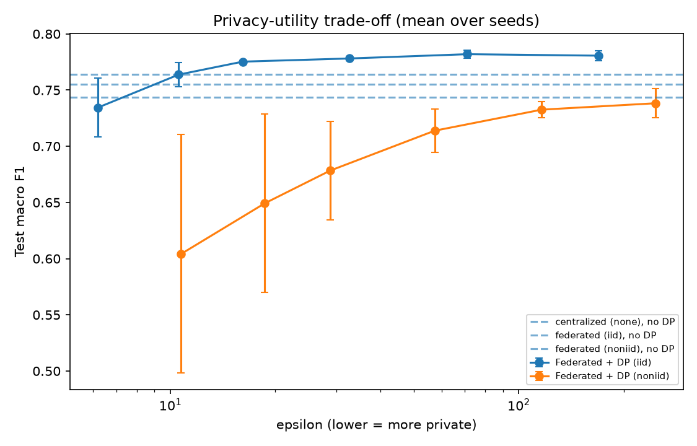
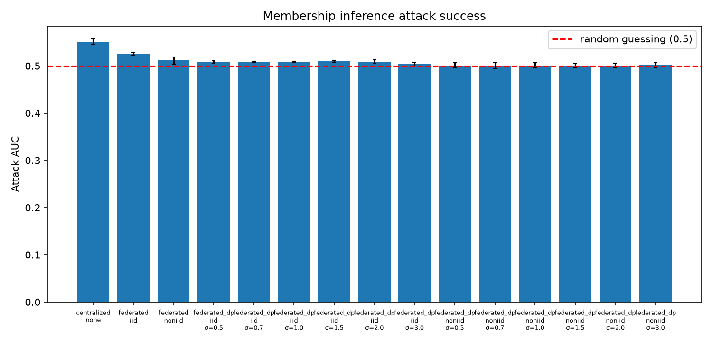
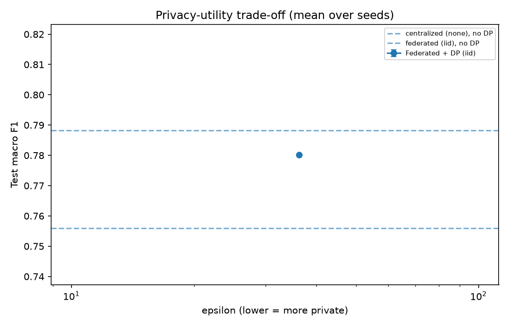

# Private Federated Learning: accuracy, privacy and attacks

Several organisations each hold private data. This project trains **one shared model without any of them sharing raw records**, adds **differential privacy** (noise during training), and then **attacks the model** to see how much it leaks.

Built with PyTorch, Opacus, scikit-learn and MLflow. Federated averaging (FedAvg) is implemented from scratch.

## What it does

1. **Centralized baseline:** all data in one place, as the reference.
2. **Federated learning (FedAvg):** 5 simulated clients train locally and a server averages their model weights. Tested with an even split (IID) and a skewed split (non-IID, Dirichlet alpha = 0.5).
3. **Differential privacy (DP-SGD):** per-client gradient clipping plus Gaussian noise using Opacus, swept over six noise levels. Privacy is reported as epsilon (lower = more private, delta = 1e-5).
4. **Membership inference attack:** a loss-threshold attacker guesses whether a record was in the training data. Attack AUC of 0.5 means random guessing.

## Setup

| Item | Choice |
|---|---|
| Data | UCI Adult (Census Income), Becker and Kohavi, 1996, DOI 10.24432/C5XW20 |
| Task | Predict income above 50K; the `fnlwgt` sampling weight is dropped |
| Model | MLP, 102 inputs, 64, 32, 2 outputs |
| Clients | 5, sizes unequal in the non-IID case |
| Training | 15 rounds, SGD, learning rate 1.0, batch size 64, clip norm 1.0 |
| Noise levels | sigma = 0.5, 0.7, 1.0, 1.5, 2.0, 3.0 |
| Seeds | 3 (0, 1, 2); results are means over seeds |
| Metrics | Test macro F1 (main), accuracy, AUC, attack AUC, epsilon |

Two regimes were run:
- **Main:** 10,000 training rows, 2 local epochs per round.
- **Overfitting regime:** 3,000 training rows, 10 local epochs per round. The model memorizes its data here, so the attack has something to find.

## Results

### Overfitting regime (3,000 rows, 10 local epochs, mean of 3 seeds)

| Setting | Train acc | Test acc | Macro F1 | Attack AUC | Epsilon* |
|---|---|---|---|---|---|
| Centralized | 0.969 | 0.824 | 0.744 | 0.551 | none |
| Federated, IID | 0.891 | 0.821 | 0.764 | 0.526 | none |
| Federated, non-IID | 0.868 | 0.837 | 0.755 | 0.511 | none |
| Federated + DP, IID, sigma 0.5 | 0.875 | 0.851 | 0.781 | 0.508 | 169 |
| Federated + DP, IID, sigma 1.0 | 0.868 | 0.849 | 0.778 | 0.508 | 33 |
| Federated + DP, IID, sigma 2.0 | 0.848 | 0.837 | 0.764 | 0.509 | 10.6 |
| Federated + DP, IID, sigma 3.0 | 0.827 | 0.821 | 0.734 | 0.504 | 6.2 |
| Federated + DP, non-IID, sigma 1.0 | 0.843 | 0.833 | 0.714 | 0.501 | 57 |
| Federated + DP, non-IID, sigma 3.0 | 0.791 | 0.794 | 0.604 | 0.502 | 10.7 |

\*Worst client, record-level (epsilon, delta = 1e-5), averaged over seeds. Full table: `results_overfit/summary.csv`.




### Main regime (10,000 rows, 2 local epochs, mean of 3 seeds)

> Fill in from `results/summary.csv` (run `python plots.py`). Do not publish numbers you have not measured.



## Findings

- **The model memorizes, and the attack picks it up a little.** The centralized model has 0.969 train accuracy against 0.824 test accuracy, and the attack reaches 0.551 AUC, outside the seed-to-seed spread (0.006) but still a weak signal.
- **Federated averaging leaked less in this setup:** attack AUC fell from 0.551 (centralized) to 0.526 (IID) and 0.511 (non-IID). The cause was not tested.
- **DP brought the attack to about chance** (0.50 to 0.51) and closed the train-test gap.
- **The attack cannot rank DP strengths.** It sits near 0.5 for every sigma, even epsilon = 169, so the formal epsilon, not the attack, is what separates the settings.
- **Utility cost of DP is small at moderate noise.** On IID data, F1 went from 0.764 (no DP) to 0.734 at sigma = 3.0.
- **DP runs scored higher than non-private federated runs** at low sigma (F1 0.781 against 0.764). A possible explanation is that clipping and noise act as regularization when 10 local epochs overfit a small dataset, but this was not tested and the comparison is not fully controlled.
- **Non-IID data plus strong noise is unstable:** F1 fell to 0.604 at sigma = 3.0, with a seed-to-seed standard deviation of 0.106 (0.007 for non-private non-IID).

## Limitations

- Epsilon values are large (6 to 246). Above roughly 10 the guarantee is generally considered weak, so only the highest-noise settings give a modest guarantee. The epsilon is per client, record-level, and taken from the worst client. Opacus also warned that its alpha range may make the bound looser than necessary.
- The loss-threshold attack is weak, so chance-level attack AUC does not prove privacy.
- The learning rate (1.0) was picked from a short sweep that looked at test-set scores. The three candidates were very close, but a proper validation split would be cleaner.
- Preprocessing (scaling, encoding) is fitted on the pooled training set, which a real deployment could not do.
- One dataset, 3 seeds, simulated clients on one machine.
- Opacus Secure RNG was turned off for speed (as its own warning notes). It should be on for production.

## Project structure

```
data.py             load Adult, preprocess, IID / non-IID partitions
model.py            MLP
fl.py               clients, FedAvg, DP-SGD with Opacus, evaluation
attacks.py          membership inference attack
run_experiments.py  runs every configuration, saves CSVs, logs to MLflow
plots.py            summary table and plots
results/            main regime outputs
results_overfit/    overfitting regime outputs
```

## How to run (Windows PowerShell)

Requirements: Python 3.11+.

```powershell
git clone https://github.com/Karal-maks/private-federated-learning.git
cd private-federated-learning
python -m venv .venv
.venv\Scripts\Activate.ps1
python -m pip install --upgrade pip
pip install torch --index-url https://download.pytorch.org/whl/cpu
pip install opacus scikit-learn pandas numpy matplotlib mlflow

# data (UCI)
Invoke-WebRequest -Uri "https://archive.ics.uci.edu/ml/machine-learning-databases/adult/adult.data" -OutFile adult.data

# main experiment
python run_experiments.py
python plots.py

# overfitting regime
$env:N_TRAIN = "3000"; $env:LOCAL_EPOCHS = "10"; $env:RESULTS_DIR = "results_overfit"
python run_experiments.py
python plots.py
Remove-Item Env:N_TRAIN, Env:LOCAL_EPOCHS, Env:RESULTS_DIR
```

Set `QUICK=1` for a fast smoke test (1 seed, 5 rounds, 2 noise levels). Browse tracked runs with `mlflow ui`.

## Author

Karal Maks, [LinkedIn](https://linkedin.com/in/KARALMAKS), [GitHub](https://github.com/Karal-maks)